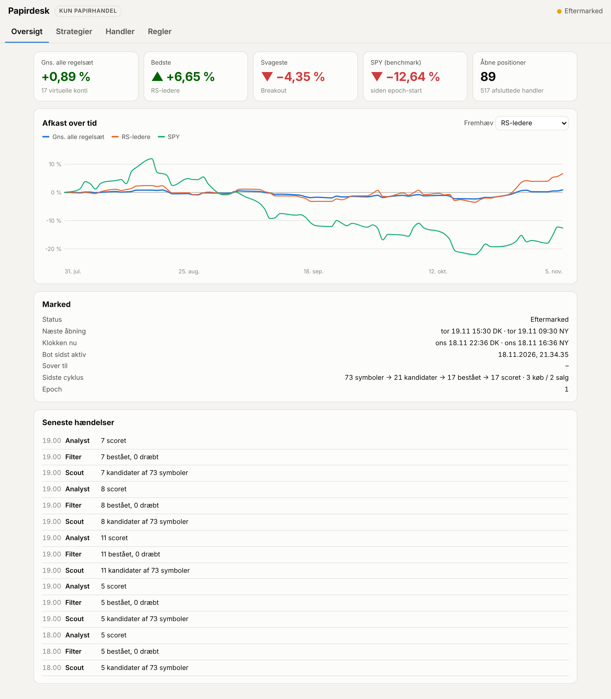

# Papirdesk

En papirhandels-bot ("desk") til amerikanske aktier (S&P 500-konstituenter) og de største ETF'er.

> **Kun papirhandel med fiktive penge.** Der findes ingen kode, der kan sende ordrer til en
> rigtig mægler. Executor ændrer kun tal i `state.json`.

- Ren **Python 3.11+ standardbibliotek**, ingen afhængigheder.
- Gratis data: Yahoo Finance (kurser), Nasdaq.com (bid/ask, earnings-kalender), NasdaqTrader (handelsstop).
- Seks agenter med hårde overdragelser, 17 regelsæt på hver sin virtuelle konto, skyggehandler,
  dansk mobilvenligt dashboard, ntfy-notifikationer, systemd-drift og en historisk backtest.

## Kom i gang

```bash
git clone <repo> /opt/papirdesk && cd /opt/papirdesk
python3 -m unittest discover -s tests -t .
python3 backtest.py              # valgfrit: historisk backtest (~10 min første gang)
python3 bot.py                   # bot + dashboard på http://localhost:8787
```

`python3 bot.py --once` kører én cyklus med det samme (henter data, scorer og handler kun hvis
markedet er åbent) og stopper. `python3 dashboard.py` starter kun dashboardet.

## Indstillinger udefra

`DESK_PORT` og `DESK_HOST` ændrer dashboardets port og vært (standard 8787 og 0.0.0.0), og `DESK_DATA_DIR` og `DESK_STATE_FILE` flytter
data og papirbog. Det bruger Hub AI til at starte botten på sin egen port uden at åbne den for netværket.

## Arkitektur

```
Snapshot ─► Scout ─► Candidate ─► Filter ─► Passed ─► Analyst ─► Scored ─► Risk ─► Order ─► Executor ─► Fill
                                                                                                │
                              Logger (SQLite: cyklusser, hændelser, overdragelser, handler,    ◄┘
                                      egenkapital, skyggehandler)
```

Overdragelserne er frosne dataklasser (`desk/models.py`); hver agent kan kun læse den forrige
agents output. Alle overdragelser logges i tabellen `handoffs`.

| Agent | Fil | Opgave |
|---|---|---|
| **Scout** | `desk/agents/scout.py` | Finder kandidater: stor relativ volumen (justeret for tid på dagen), gap op/ned, nye 52-ugers toppe. Desuden `pullback` og `oversold` til dip-køb/mean reversion. |
| **Filter** | `desk/agents/filter.py` | Dræber: lav gennemsnitsvolumen/omsætning, kurs < 5 USD, bred spread (bid/ask fra Nasdaq), earnings inden for X dage, handelsstop (NasdaqTrader RSS + ingen handler i 15 min), for kort historik. |
| **Analyst** | `desk/agents/analyst.py` | Score 0-100 af seks komponenter: momentum, relativ styrke mod sektor-ETF og SPY, volumen, trend (SMA20/50/200), volatilitet (ATR mod ideelt bånd), markedets retning via SPY. |
| **Risk** | `desk/agents/risk.py` | Initialt stop = entry − k×ATR, trailing stop = top − k×ATR, maks. stopafstand, maks. eksponering pr. sektor. Overvåger åbne positioner (stop, trailing, gevinstmål, holdetid, regelsættets exit). |
| **Executor** | `desk/agents/executor.py` | Fast procent af kontoen pr. handel, slippage (+ halv spread), kommission, maks. antal positioner, karantæne efter salg, ingen handler det første minut efter åbning. |
| **Logger** | `desk/agents/logger.py` | Eneste agent der skriver til `data/desk.sqlite`. |

`desk/pipeline.py` (`Desk.run_cycle`) samler kæden og bruges af både botten og backtesten.

## Markedstid

`desk/market_clock.py` regner i `America/New_York` (zoneinfo håndterer sommertid, som skifter på
andre datoer end i Danmark). NYSE-helligdage beregnes for ethvert år (inkl. langfredag via
påskeberegning og "observed"-reglerne), halve dage kl. 13:00 (3. juli, dagen efter Thanksgiving,
juleaften) og ekstraordinære lukninger i `config.EXTRA_HOLIDAYS`.

| Fase (NY-tid) | Bottens adfærd |
|---|---|
| ~08:45 | Forberedelse: univers (Wikipedia, cachet 7 dage), dagsbarer, earnings-kalender |
| 04:00-09:30 førmarked | Handler ikke, sover til åbning + 1 min |
| 09:30-16:00 åbent | Cyklus hvert 10. minut (`SCAN_INTERVAL_MINUTES`) |
| 16:00-20:00 eftermarked | Dagsafslutning én gang: daglig egenkapital, skyggehandler, ntfy-resumé |
| Ellers / weekend / helligdag | Sover til næste forberedelse (i bidder af højst 15 min) |

## Regelsæt (strategitest)

17 regelsæt kører side om side, hver på sin egen virtuelle konto (`desk/strategies.py`):

Basis · Momentum · Breakout · Mean reversion · Gap op · Gap ned-rebound · Dip-køb i optrend ·
Kræsen · Aggressiv · Mange små · Trendfølger · RS-ledere · Volumenstød · Lav volatilitet ·
ETF-rotation · Markedsfilter · Hurtig swing.

Hvert regelsæt kan sætte: hvilke Scout-signaler det reagerer på, en indgangsregel, egne score-vægte,
minimumsscore, positionsstørrelse, maks. positioner, ATR-stop/trailing, gevinstmål, maks. holdetid,
sektorloft, univers (aktier/ETF) og SPY-filter. Alt der ikke er sat, arves fra `config.py`.
Den fulde regeltabel vises i dashboardets **Regler**-fane.

**Skyggehandler:** alle aktier som Analysten scorer, registreres som fiktive køb i tabellen `shadow`.
Ved dagsafslutning udfyldes afkastet efter 1, 5 og 10 handelsdage, så man kan se om højere score
faktisk giver højere afkast (vises i **Handler**-fanen).

**Nulstilling:** hæv `EPOCH` i `config.py` og genstart. Den gamle papirbog gemmes som
`state.epoch-<n>.json`, alle konti starter forfra, og dashboardet viser kun den nye epoch.

## Papirbogen – `state.json`

Portabel JSON med én konto pr. regelsæt (kontanter, positioner med stop/trailing, karantæne,
daglig afkasthistorik, antal handler/gevinster, drawdown). Skrives atomisk. Kopiér filen til en
anden maskine for at flytte desken. Den interne regneenhed (`START_EQUITY`) vises aldrig –
**dashboardet viser altid papirpenge i procent**.

## Dashboard

`http://<maskine>:8787` – dansk, mobilvenligt, lyst/mørkt tema efter systemet.

- **Oversigt:** markedsstatus (åbent/lukket/før-/eftermarked, næste åbning i dansk og NY-tid),
  nøgletal, "Afkast over tid" med blød kurve (gennemsnit, valgt regelsæt og SPY), hændelseslog.
- **Strategier:** kort pr. regelsæt med afkast, minikurve, hitrate, maks. fald, investeringsgrad,
  plus resultaterne af den historiske backtest.
- **Handler:** åbne positioner, afsluttede handler (resultat i %), skyggehandel-statistik.
- **Regler:** alle tærskler fra `config.py` og regeltabellen for alle regelsæt.

Dashboardet er kun-læsning og har ingen login. Udsæt det ikke direkte på internettet – brug fx
VPN/Tailscale eller sæt `DASHBOARD_HOST = "127.0.0.1"`.

## Notifikationer (ntfy)

Sæt `NTFY_TOPIC` i `config.py` til et svært gætteligt emne og abonnér i ntfy-appen.
Der sendes besked ved handler, et dagligt resumé (top 5 og gennemsnit i %) og fejl.
Egen ntfy-server: `NTFY_SERVER`.

## Drift som systemd-service (24/7)

```bash
sudo useradd --system --home /opt/papirdesk papirdesk
sudo chown -R papirdesk: /opt/papirdesk
sudo cp deploy/papirdesk.service /etc/systemd/system/
sudo systemctl daemon-reload
sudo systemctl enable --now papirdesk
journalctl -u papirdesk -f
```

Servicen har `Restart=always`. Botten fanger selv fejl i løkken (logger, ntfy'er og prøver igen
med stigende pause), og systemd genstarter den, hvis processen alligevel dør. Efter genstart
fortsætter den fra `state.json`.

## Historisk backtest

```bash
python3 backtest.py                     # 5 års dagsdata, alle regelsæt
python3 backtest.py --max-symbols 100   # hurtigere
python3 backtest.py --start 2024-01-01  # delperiode
```

Resultatet gemmes i `backtest_results.json` (vises i dashboardet) og `BACKTEST.md`.
Backtesten bruger de samme agenter som live-botten, men med dagsbarer: beslutning ved luk,
udførelse ved næste dags åbning, stop tjekkes mod dagens lav (gap under stop fyldes til åbningskursen).

### Seneste resultat (2022-11-21 – 2026-11-18, 543 symboler, 1002 handelsdage)

| | Afkast | CAGR | Maks. fald | Sharpe |
|---|---:|---:|---:|---:|
| SPY køb og hold | +94,9 % | +18,2 % | 18,8 % | 1,18 |
| Gns. alle 17 regelsæt | +51,1 % | – | 10,5 % | – |
| Markedsfilter (bedst) | +109,2 % | +20,3 % | 11,2 % | 1,51 |
| Kræsen | +90,1 % | +17,5 % | 8,5 % | 1,53 |
| RS-ledere | +72,6 % | +14,7 % | 17,5 % | 0,99 |
| Lav volatilitet (svagest) | +7,4 % | +1,8 % | 12,2 % | 0,22 |

Kun to regelsæt slog SPY på afkast, men flere havde mindre fald og bedre Sharpe. Begge vindere
handler kun når markedet (SPY) er i optrend. **Vigtigt:** skyggehandlerne viser, at Analystens
basis-score *ikke* forudsiger afkast – aktier med score under 20 gav højere 5- og 10-dages afkast
end aktier med score over 80 (kortsigtet mean reversion). Score-vægtene i `config.py` bør derfor
justeres, før scoren tillægges vægt. Fuld tabel: `BACKTEST.md`.



Forbehold: universet er *nuværende* S&P 500-konstituenter (survivorship bias); historiske
earnings-datoer, spreads og handelsstop kendes ikke, så de filtre er passive i backtesten;
relativ volumen er hele dagens volumen. Se `BACKTEST.md` for de seneste tal.

## Konfiguration

Alle tærskler bor i `config.py`, grupperet efter agent. De vigtigste:

| Nøgle | Standard | Betydning |
|---|---|---|
| `SCOUT_MIN_RVOL` | 1,8 | Min. relativ volumen |
| `SCOUT_GAP_PCT` | 2 % | Gap op/ned |
| `MIN_AVG_VOLUME` | 1 mio. | Min. 20-dages gennemsnitsvolumen |
| `MAX_SPREAD_PCT` | 0,15 % | Maks. spread |
| `EARNINGS_BLACKOUT_DAYS` | 3 | Ingen køb så tæt på earnings |
| `ATR_STOP_MULT` / `ATR_TRAIL_MULT` | 2 / 3 | Stop og trailing i ATR |
| `MAX_SECTOR_PCT` | 30 % | Maks. eksponering pr. sektor |
| `POSITION_PCT` | 8 % | Andel af kontoen pr. handel |
| `MAX_OPEN_POSITIONS` | 10 | Maks. åbne positioner |
| `SLIPPAGE_BPS` | 5 | Slippage + halv spread |
| `QUARANTINE_DAYS` | 3 | Karantæne efter salg |
| `NO_TRADE_FIRST_MINUTES` | 1 | Ingen handler lige efter åbning |
| `EPOCH` | 1 | Hæv for at nulstille |

## Filer

```
config.py                  alle tærskler
bot.py / dashboard.py / backtest.py   indgange
desk/market_clock.py       børstid, helligdage, sessioner
desk/data.py               Yahoo / Nasdaq / NasdaqTrader (stdlib urllib)
desk/universe.py           S&P 500 (Wikipedia) + top-ETF'er
desk/indicators.py         SMA, ATR, RSI, features
desk/agents/*.py           de seks agenter
desk/strategies.py         regelsættene
desk/pipeline.py           én cyklus (live og backtest)
desk/ledger.py             papirbogen state.json
desk/backtest.py           historisk backtest
desk/dashboard.py, static/ dashboard
desk/notify.py             ntfy
deploy/papirdesk.service   systemd
tests/                     unittest (ingen netværk)
```

## Tests

```bash
python3 -m unittest discover -s tests -t .
```

Dækker kalender (helligdage, halve dage, sommertid, næste åbning), indikatorer, hver agent,
papirbog/epoch, en hel cyklus, backtest på syntetiske data, parsere og dashboardets API.

## Ansvarsfraskrivelse

Undervisnings- og eksperimentværktøj. Ikke investeringsrådgivning. Data fra gratis kilder kan være
forsinkede, ufuldstændige eller ændre format uden varsel. Kun papirhandel.
